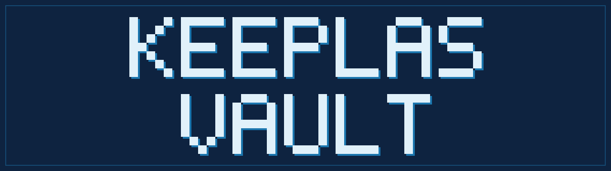

<p align="center">
  
</p>

# Keeplas Vault

<p align="center">
  <a href="https://keeplas.com/docs"></a>
  <a href="https://github.com/Keeplas/keeplas/discussions"></a>
  <a href="https://www.keeplas.com/security"></a>
  <a href="./license.md"></a>
  <a href="https://github.com/Keeplas/keeplas/discussions"></a>
</p>

> Open-source **Life Continuity Platform** — securely store, organize, and transmit vital information to trusted contacts.

Keeplas helps users protect what matters: financial assets, medical directives, legal legacy, and trusted contacts — all encrypted client-side and transmitted only under conditions the user defines. No one (not even Keeplas) can read the vault without the user's consent.

- **Continuity** — your loved ones get access to vital info if you become incapacitated or pass away.
- **Security** — zero-knowledge architecture; secrets never leave the device unencrypted.
- **Control** — you decide who accesses what, when, and under which conditions.

License: **AGPL-3.0-only** + Contributor License Agreement. Self-hostable.

## Project status

Keeplas is moving to **mobile-first** (v2, in progress since October 2026):

1. **Mobile app (`apps/mobile`, Expo)**: the primary app. Accounts are created here only, with a phone number verified by a WhatsApp code.
2. **Web app (`apps/web`)**: the companion. There is no web sign-up. You link a computer by scanning a QR code with the phone, then sign in with a passkey.

Phase-by-phase progress and decisions: [`PRD/v2-mobile-first/README.md`](./PRD/v2-mobile-first/README.md).

---

## Stacks

**Mobile**

- **Expo SDK 57 + React Native 0.86**: iOS and Android app, file-based routing with **Expo Router**
- **`expo-dev-client`**: custom dev build (native modules for passkeys, biometrics and secure storage), so Expo Go is not supported
- **EAS Build / Submit**: cloud builds and store releases (see [`apps/mobile/README.md`](./apps/mobile/README.md))
- **Jest**: unit tests

**Web**

- **TanStack Start (Vite) + React 19** — type-safe file-based routing, runs as an SPA with a server runtime for request middleware + API routes
- **Tailwind CSS v4** + **shadcn/ui** + **Radix UI** primitives — design system (Tooltip and DatePicker still on `@base-ui/react`, migrated when touched)
- **Tiptap 3** — rich text editor for vault content
- **lucide-react** — icon set
- **cmdk** — command palette
- **Preference-based i18n** — English/French dictionaries (`en`/`fr`) with an in-app language switcher (the marketing site routes locale via URL)
- **libphonenumber-js** — phone number parsing for WhatsApp OTP
- **qrcode.react**, **html2canvas-pro**, **jspdf** — Emergency Card rendering & PDF export

**Backend**

- **[Convex](https://www.convex.dev/)** (`^1.35.1`) — realtime backend & DB, cloud or self-hosted (`CONVEX_MODE=selfhosted`)
- **Convex Auth** + **`@auth/core`** — auth foundation
- **`@simplewebauthn/{browser,server}`** — WebAuthn (Passkey) — phishing-resistant, biometric-local auth
- **WhatsApp Cloud API** — OTP secondary verification channel
- **Expo push service** — native push to the phone app (security alerts, Life Check)
- **[Resend](https://resend.com/)** — transactional email (Life Check, OTP, contact form)

**Cryptography** (gated by CODEOWNERS in `packages/crypto/`)

- **`@noble/post-quantum`** — ML-KEM-768 (NIST FIPS 203) wraps per-recipient DEKs; ML-DSA-65 (NIST FIPS 204) signs each user's ML-KEM public key for authenticated key distribution (TOFU)
- **`hash-wasm`** — Argon2id KDF for the 24-word root phrase
- **AES-GCM** (WebCrypto) — content encryption
- **Vitest** — unit tests for the crypto primitives

**Tooling**

- **Turborepo + pnpm** monorepo
- **TypeScript 5**, **ESLint 9**, **Prettier**
- **Docker** (`Dockerfile.dev` + `docker-compose.yml`) for an optional containerized dev environment

## Monorepo layout

```
apps/
  mobile/               Expo (React Native) app: iOS + Android, primary app
  web/                  TanStack Start (Vite) app (PWA-ready), linked from the phone
packages/
  convex/               Convex schema, queries, mutations, actions  (@keeplas/backend)
  crypto/               Zero-knowledge crypto: AES, KDF, KEM, Shamir, recovery  (RESTRICTED)
  ui/                   Shared UI components built on Radix / shadcn pattern
PRD/                    Product specs, architecture recap, design wireframes
security/               Security policy and audit material
scripts/                Maintenance scripts (env check, Convex env sync, env linking)
```

`packages/crypto/` is gated by **CODEOWNERS** — only founders can merge changes there.

## Requirements

- Node.js **>= 20**
- pnpm **>= 10** (`corepack enable` recommended)
- A Convex deployment (cloud or self-hosted) — see [Convex docs](https://docs.convex.dev)
- Mobile, iOS: macOS with **Xcode** (includes the iOS Simulator) and CocoaPods
- Mobile, Android: **Android Studio** (Android SDK + an emulator), JDK 17, and `ANDROID_HOME` set (usually `~/Library/Android/sdk` on macOS)

## Quick start (native)

Run every step in order — none are optional for a first run:

```bash
# 1. One-command bootstrap: copies .env.local, installs, links per-package envs,
#    then provisions your Convex deployment (interactive, opens a browser —
#    writes CONVEX_DEPLOYMENT + NEXT_PUBLIC_CONVEX_URL into .env.local)
pnpm bootstrap

# 2. Generate the audit HMAC secret, then paste it into .env.local
openssl rand -base64 32
# → set KEEPLAS_CTX_SECRET=<output> in .env.local

# 3. Seed Convex Auth's JWT keys on the deployment (REQUIRED — without this
#    the first sign-in throws "Missing environment variable JWT_PRIVATE_KEY")
npx @convex-dev/auth

# 4. Push the rest of your local env to Convex (REQUIRED — audited mutations
#    fail if KEEPLAS_CTX_SECRET doesn't match on the server)
pnpm sync:convex-env

# 5. Verify everything is in sync
pnpm check:convex          # must be green before continuing

# 6. Boot the app — Convex env check runs in the background, never blocks
pnpm dev
```

`pnpm dev` starts two things: the Convex watcher (`npx convex dev`) and the web app on <http://localhost:3000>. It does **not** start the mobile app.

Sign-up only exists in the mobile app, so a first run continues there: start the app (next section), create an account on the phone, then open <http://localhost:3000> and scan the QR code with the app to link the computer.

> Whenever you edit anything under `packages/convex/`, `pnpm dev` already runs `convex dev` in parallel to regenerate types. Pre-push, `pnpm check:convex` validates the deployment env one last time.

## Run the mobile app

Keep `pnpm dev` running in one terminal (the app talks to the same Convex deployment and calls the web app's `/api/context`), and use a second terminal for the app.

The app reads `EXPO_PUBLIC_CONVEX_URL` and `EXPO_PUBLIC_APP_URL` from the root `.env.local` (symlinked by `pnpm link:env`, which `pnpm bootstrap` already ran). Set `EXPO_PUBLIC_CONVEX_URL` to the same value as `NEXT_PUBLIC_CONVEX_URL`.

### iOS Simulator (macOS)

```bash
open -a Simulator                                     # open the simulator
xcrun simctl list devices available                   # list installed iPhones
pnpm --filter @keeplas/mobile ios                     # build, install and launch the app
pnpm --filter @keeplas/mobile ios -- --device "iPhone 16"   # pick a specific simulator
```

### Android emulator

Create an emulator once in Android Studio (Device Manager → Create device), then:

```bash
$ANDROID_HOME/emulator/emulator -list-avds            # list your emulators
$ANDROID_HOME/emulator/emulator -avd <name> &         # boot one
adb reverse tcp:3000 tcp:3000                         # let the emulator reach the web app on localhost:3000
pnpm --filter @keeplas/mobile android                 # build, install and launch the app
```

Run `adb reverse` again each time the emulator restarts. Without it, `http://localhost:3000` inside the emulator points at the emulator itself, not your computer.

### Daily loop

The first `ios` / `android` run compiles the native app (a few minutes) and installs a dev build on the simulator. After that you only need the JS bundler:

```bash
pnpm --filter @keeplas/mobile start                   # then press i (iOS) or a (Android)
```

Rebuild with `ios` / `android` only after adding or upgrading a native dependency, or after changing `app.json` / `app.config.ts`.

### Physical device

Plug the phone in and run `pnpm --filter @keeplas/mobile ios -- --device` (or `android` with USB debugging on). Set `EXPO_PUBLIC_APP_URL` to your computer's LAN address or a tunnel URL (e.g. `http://192.168.1.20:3000`) instead of `localhost`, then restart the bundler.

EAS builds, push notifications and store release: see [`apps/mobile/README.md`](./apps/mobile/README.md).

## Daily commands

| What                 | Command                                    |
| -------------------- | ------------------------------------------ |
| Backend + web app    | `pnpm dev`                                 |
| Mobile, iOS          | `pnpm --filter @keeplas/mobile ios`        |
| Mobile, Android      | `pnpm --filter @keeplas/mobile android`    |
| Mobile, bundler only | `pnpm --filter @keeplas/mobile start`      |
| Checks before a PR   | `pnpm lint && pnpm typecheck && pnpm test` |

For the full bootstrap including the auth-key chicken-and-egg dance, see [`CONTRIBUTING.md`](./CONTRIBUTING.md#first-time-setup). For the system overview, see [`docs/ARCHITECTURE.md`](./docs/ARCHITECTURE.md).

## Try it (Docker)

A containerized dev environment is provided as an alternative to a local Node install. It pins **Node 22** and **pnpm 10.8.1** to match CI, with bind-mounted source (so host edits hot-reload) and named volumes for `node_modules`, `dist/`, `.turbo/`, and `.convex/` state.

```bash
cp .env.example .env.local                      # then fill KEEPLAS_CTX_SECRET
docker compose up                               # installs + starts dev server on :3000
```

Docker covers the web app and Convex only. The mobile app needs Xcode or Android Studio on the host (see [Run the mobile app](#run-the-mobile-app)).

Full Docker workflow (provisioning Convex inside the container, running ad-hoc commands via `compose exec`, common gotchas, when to use Docker vs native): see [`docs/DOCKER.md`](./docs/DOCKER.md).

> The image is **`Dockerfile.dev`** — not production-ready. The web app builds with `vite build` (TanStack Start / Nitro) and can deploy to any Node host or a Nitro preset (Vercel, Netlify, Cloudflare); the backend runs on Convex Cloud. No production Dockerfile is shipped.

## Environment variables

All required variables are documented in [`.env.example`](./.env.example). High-level groups:

- **Application** — `NEXT_PUBLIC_APP_URL`, `APP_URL`, `NODE_ENV`
- **Convex** — `CONVEX_MODE` (`cloud` | `selfhosted`), `CONVEX_DEPLOYMENT`, `NEXT_PUBLIC_CONVEX_URL`, `SITE_URL`
- **WebAuthn** — `WEBAUTHN_RP_ID`, `WEBAUTHN_RP_NAME`, `WEBAUTHN_ORIGIN`
- **Audit context (required)** — `KEEPLAS_CTX_SECRET` (HMAC; the **same value** must exist in `.env.local` AND on the Convex deployment — `pnpm check:convex` enforces this)
- **Email — Resend (required for email auth)** — `RESEND_API_KEY`, `RESEND_FROM_EMAIL`; optional `SUPPORT_INBOX_EMAIL` for the contact form
- **Native push — Expo (optional)** — `EXPO_ACCESS_TOKEN` — authenticates phone push (security alerts, Life Check) once Enhanced Push Security is on
- **WhatsApp — Infobip (optional)** — `INFOBIP_*`, `WHATSAPP_*_TEMPLATE_NAME` — Life Check WhatsApp channel and WhatsApp OTP verification
- **Mobile app** — `EXPO_PUBLIC_CONVEX_URL`, `EXPO_PUBLIC_APP_URL`, `EXPO_PUBLIC_GCP_PROJECT_NUMBER` (Android only), `GOOGLE_SERVICES_JSON` (Android push). Expo inlines `EXPO_PUBLIC_*` into the app bundle, so they are public values, never secrets

Two env files cover the split:

- `.env.local` — `NEXT_PUBLIC_*` vars are inlined into the client bundle by Vite at build time (see `apps/web/vite.config.ts`); server-only secrets are read from `process.env` at runtime by the request middleware (`apps/web/src/start.ts`)
- `.env.convex.local` — backend-only values that should NOT be loaded into the web process (e.g. `SITE_URL`)

> The `NEXT_PUBLIC_` prefix is kept (rather than Vite's `VITE_`) so existing references and the Convex env sync keep working unchanged after the TanStack Start migration.

Both are read by `pnpm sync:convex-env` and pushed to the Convex deployment.

Generate the audit secret with `openssl rand -base64 32`. `pnpm check:env` runs automatically before `pnpm dev` and `pnpm build` (fast, local). The slower `pnpm check:convex` (round-trips to the deployment) is manual — also fires in the background during `pnpm dev` and warns on drift without blocking.

For the full Convex workflow (provisioning, schema changes, JWT bootstrap, env sync), see [`docs/CONVEX.md`](./docs/CONVEX.md). For the Docker workflow, see [`docs/DOCKER.md`](./docs/DOCKER.md).

## Pricing

Keeplas ships with a deliberately simple two-tier model — **no monthly subscription**:

| Plan         | Price          | Storage | Highlights                                                                                                                                                                          |
| ------------ | -------------- | ------- | ----------------------------------------------------------------------------------------------------------------------------------------------------------------------------------- |
| **Free**     | $0 / forever   | 100 MB  | Zero-knowledge vault, monthly Life Check, 1 emergency contact, digital Emergency Card                                                                                               |
| **Lifetime** | $99 / one-time | 10 GB   | Full Scenario Engine, up to 3 trust contacts, priority Social Recovery, physical Emergency Card, video legacy messages, weekly Life Check, priority support, more storage as add-on |

Both tiers run the same zero-knowledge encryption — only the surface area changes. Switching plans never deletes your vault.

## Scripts

| Command                | Description                                                                                                       |
| ---------------------- | ----------------------------------------------------------------------------------------------------------------- |
| `pnpm bootstrap`       | One-command bootstrap (`.env.local`, install, link envs, provision Convex, prints next steps)                     |
| `pnpm dev`             | Start `convex dev` + the web app. Convex env check runs in the background — never blocks boot (mobile: see above) |
| `pnpm build`           | Production build for every workspace                                                                              |
| `pnpm lint`            | ESLint across the monorepo                                                                                        |
| `pnpm typecheck`       | TypeScript `--noEmit` across all packages                                                                         |
| `pnpm test`            | Run every test suite (Vitest for web, Convex, crypto, UI; Jest for mobile)                                        |
| `pnpm format`          | Prettier write on `**/*.{ts,tsx,js,jsx,json,css,md}`                                                              |
| `pnpm clean`           | Remove build artifacts (`dist`, `.output`, `.turbo`)                                                              |
| `pnpm check:env`       | Validate `.env.local` is complete (runs as predev/prebuild — fast, local-only)                                    |
| `pnpm check:convex`    | Validate that the Convex deployment has every required server-side var (manual, pre-push — `~30s round-trip`)     |
| `pnpm sync:convex-env` | Push secrets from `.env.local` + `.env.convex.local` to the Convex deployment                                     |
| `pnpm link:env`        | Symlink `.env` files across workspaces                                                                            |

## Security model

- **Master Key** and **Recovery Phrase (24 words)** never leave the client unencrypted. The master key is never split — trusted contacts hold no part of it.
- The **24-word phrase** is the root crypto secret (Argon2id-derived). The **password is pure auth** and is resettable via the 24 words.
- **No OAuth.** Trusted contacts confirm when the owner is unreachable (2 confirmations + a 72h owner-cancellable grace window); each recipient then receives only the items assigned to them. A missed Life Check alone never releases anything.
- **Authenticated key distribution (TOFU).** Each user holds an **ML-DSA-65 (FIPS 204)** identity key; their ML-KEM public key is signed with it. Clients verify the signature and pinned fingerprint before wrapping a DEK to a contact — never trusting a server-provided pubkey unverified. The identity secret key is wrapped under the master key and never sent in clear.
- Sensitive auth flows enforce a **step-up gate** (login-OTP + TOTP) on top of the password; auth/onboarding/public flows are intentionally exempt.
- Per-device unlock combines **PIN**, **biometric (PRF)**, and **hardware key (PRF)** — RootKey wraps live in IndexedDB; the 24-word phrase is requested on first login per device.
- All sensitive cryptography is implemented in [`packages/crypto/`](./packages/crypto), gated by CODEOWNERS and unit-tested.

Report vulnerabilities to **security@keeplas.com** — see [SECURITY.md](./SECURITY.md). Do **not** open a public GitHub issue.

## Documentation

- [`docs/STACK.md`](./docs/STACK.md) — tech stack and the rationale behind each choice
- [`PRD/keeplas-architecture-recap-v5.md`](./PRD/keeplas-architecture-recap-v5.md) — full architecture, security & product decisions
- [`PRD/keeplas-convex-zk-technical-v2.md`](./PRD/keeplas-convex-zk-technical-v2.md) — Convex + zero-knowledge technical spec
- [`PRD/IMPLEMENTATION_PLAN.md`](./PRD/IMPLEMENTATION_PLAN.md) — implementation roadmap
- [`PRD/v2-mobile-first/README.md`](./PRD/v2-mobile-first/README.md) — v2 mobile-first redesign: decisions, phases, current status
- [`PRD/v2-mobile-first/figma/`](./PRD/v2-mobile-first/figma) — Figma snapshot, screen specs and design tokens (replaces `PRD/Design/`)
- [`apps/mobile/README.md`](./apps/mobile/README.md) — mobile app: EAS builds, push credentials, Play Store
- [`docs/PUSH_NOTIFICATIONS.md`](./docs/PUSH_NOTIFICATIONS.md) — native push setup (Expo, APNs, FCM) and remaining work
- [`docs/INFOBIP_INBOUND.md`](./docs/INFOBIP_INBOUND.md) — Infobip inbound WhatsApp webhook setup (Life Check liveness)
- [`docs/TRUSTED_CONTACTS.md`](./docs/TRUSTED_CONTACTS.md) — trusted contacts, release flow & availability
- [`CLAUDE.md`](./CLAUDE.md) — engineering conventions for AI assistants & humans

## Community & Discussions

Have a question, an idea, or want to share feedback? Join us in [**GitHub Discussions**](https://github.com/Keeplas/keeplas/discussions):

- **💬 Q&A** — ask how something works or get help with setup
- **💡 Ideas** — propose features or improvements
- **📣 Show & tell** — share what you built or how you use Keeplas
- **🗣️ General** — anything else community-related

Use Discussions for open-ended conversation, and [GitHub Issues](https://github.com/Keeplas/keeplas/issues) for confirmed bugs and actionable tasks. For security vulnerabilities, **do not** post publicly — email **security@keeplas.com** (see [SECURITY.md](./SECURITY.md)).

## Contributing

We welcome contributions! Please read:

- [CONTRIBUTING.md](./CONTRIBUTING.md) — workflow and code style
- [CONTRIBUTOR_LICENSE_AGREEMENT.md](./CONTRIBUTOR_LICENSE_AGREEMENT.md)
- [CODE_OF_CONDUCT.md](./CODE_OF_CONDUCT.md)

Restricted areas (founder approval required): `packages/crypto/`, `security/`.

## License

Keeplas is licensed under the **GNU AGPL v3.0** — see [`license.md`](./license.md). Contributors agree to the [CLA](./CONTRIBUTOR_LICENSE_AGREEMENT.md) so the project can evolve under a sustainable governance model.
