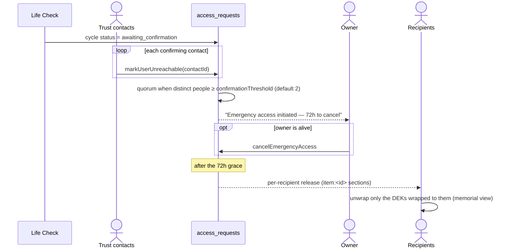

# Trusted Contacts

> How trusted contacts take part in succession — for contributors who implement or modify the
> feature. Product context and decisions: [`PRD/v2-mobile-first/README.md`](../PRD/v2-mobile-first/README.md).

## Overview

A user's vault is encrypted under a single **master key** (AES-256), sealed by the RootKey derived
from the 24-word recovery phrase (Argon2id). **The master key is never split and never leaves the
owner's devices.** Trusted contacts hold no part of it and cannot read the vault — not alone, not
together.

Every contact is a **trust contact** — one role, no cap. A trust contact:

- confirms the owner is unreachable once Life Check has exhausted every channel (any 2 confirmations
  reach the quorum);
- holds a share of the owner's recovery secret (2-of-n, never the master key) to help them recover
  access on a new phone;
- receives only the items assigned to them (directly, through a group, or through a shared folder)
  when a release fires.

The legacy `trusted_contacts.contactType` field (`trust` / `recipient_only`) is ignored and cleared
by `migrations:migrateContactTypes`; drop it from the schema once that migration has run on every
deployment.

## History: no more MasterKey shards (v2 phase 2)

Until v2, the master key was Shamir-split into 4 shares (1 in the owner's `localStorage`, 3 sealed
to trust contacts), and after a release any contact could rebuild the whole master key. That
broke the zero-access promise (findings **F1** and **F2** in
[`PRD/v2-mobile-first/README.md`](../PRD/v2-mobile-first/README.md)). It is gone:

- No client splits the master key — `pnpm check:zk` forbids `@keeplas/crypto/shamir` in `apps/web`.
- The shard endpoints (`storeEncryptedShard`, `submitRecoveryShards`, `getRecoveryShardsForMe`, …)
  are deleted.
- A one-off migration (Oct 2026) cleared every server-side shard, then the schema dropped the shard
  fields and the `recovery_shard_submissions` table. Owners whose key was ever split were flagged
  with `users.masterKeyRotationRequired`. The web app then forces a master-key rotation
  (`ForcedRotationGate` → `useRotateVault`), so any shard still sitting on a contact's device opens
  nothing.
- `purgeLegacyShards()` removes leftover shards from browsers (dashboard load + sign-out).

Owner recovery through contacts arrives in phase 5, on a **separate recovery secret** — never the
master key.

## Release flow

Backend: `packages/convex/access_requests.ts` and `packages/convex/life_check.ts`.

- **No quorum, no release.** If the confirmation window ends without quorum, the cycle is
  cancelled and nothing is released (`resolveConfirmationWindow`). The former `release_anyway`
  fallback is retired (F5).
- Each recipient decrypts only the items whose DEK was wrapped to their ML-KEM key
  (`vault_item_recipient_keys`); nothing else is reachable.
- An owner who returns after a release revokes it (`revokeReleasedAccess`) and rotates the master
  key (`ReturnAfterReleaseBanner`).

## Availability

Accepted trust contacts confirm they are still reachable: opening `/shared-with-me` unlocks their
own key material and stamps `lastVerifiedAt` (`useConfirmAvailability` →
`trusted_contacts.confirmAvailability`). The weekly `runAvailabilityReconfirm` cron nudges contacts
whose stamp is missing or older than 30 days, then alerts the owner after 3 ignored nudges.

## Security invariants

- The master key never leaves the owner's devices and is never split.
- Trust contacts hold no key material for the owner's vault.
- Before wrapping a DEK to a contact, the client verifies their ML-DSA signature and pinned
  fingerprint (`verifyContactKey`).
- A release needs a human quorum **plus** a 72h owner-cancellable grace window — never silence.
- One human counts once toward the quorum (C1 dedup by `contactUserId`).

## Key files reference

| Concern                            | File                                                                      |
| ---------------------------------- | ------------------------------------------------------------------------- |
| Invite / accept / revoke contacts  | `packages/convex/trusted_contacts.ts`                                     |
| Quorum, grace, revoke after return | `packages/convex/access_requests.ts`                                      |
| Confirmation window resolution     | `packages/convex/life_check.ts`                                           |
| Availability stamp (contact side)  | `apps/web/src/app/(dashboard)/shared-with-me/use-confirm-availability.ts` |
| Verify-before-wrap                 | `apps/web/src/lib/verify-contact-key.ts`                                  |
| Master-key rotation                | `apps/web/src/lib/use-rotate-vault.ts`, `packages/convex/rotation.ts`     |
| Legacy shard cleanup (browser)     | `apps/web/src/lib/purge-legacy-shards.ts`                                 |

## See also

- [`docs/ARCHITECTURE.md`](./ARCHITECTURE.md) — crypto boundary and workspace layout
- [`PRD/v2-mobile-first/README.md`](../PRD/v2-mobile-first/README.md) — v2 decisions and phases
